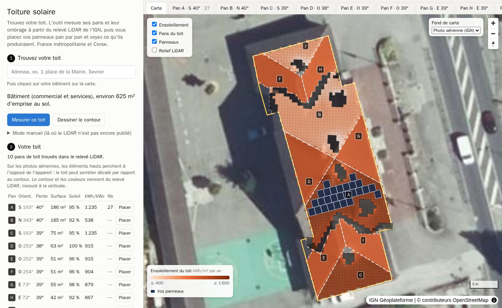
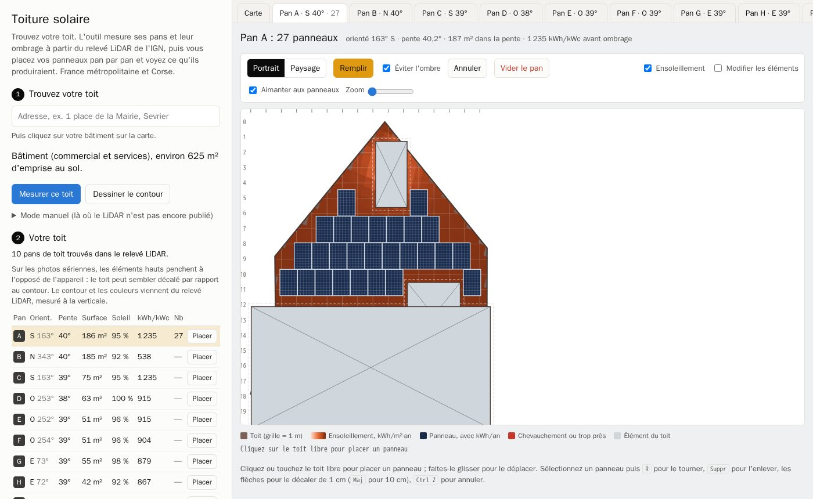

[Live]{.chip .chip-live}

Find your roof on a map and Toiture solaire measures it for you. It splits the roof into its faces, works out each face's tilt and orientation, and maps how much sun every half-metre of roof gets once chimneys, trees and neighbouring buildings are taken into account. You then place panels on each face, drawn true to size, and see what they would produce and whether they would pay for themselves.

<a class="btn-pill plausible-event-name=Open+Toiture+solaire" href="https://toiture-solaire.jeffreypost.dev">Open the app →</a>

The app is in French because it only covers France. It runs on the French mapping agency's (IGN) LiDAR HD survey, an airborne laser scan of the whole country at 50 cm resolution, and the address search, building outlines and aerial photos come from IGN too. This write-up is in English and goes through how it works, maths included.

{fig-alt="Screenshot of the app: an aerial photo of a building with its roof split into ten lettered faces, coloured from pale to dark orange by sunshine, and a block of solar panels on one face. A table on the left lists each face's orientation, tilt, area and yield."}

## What it does

1. **Find the roof.** Search an address and click a building. The outline comes from IGN's building database, or you can draw it yourself.
2. **Measure it.** The server downloads the LiDAR surface model around the building, finds the roof faces, and computes shading for every cell of every face. For a house this takes about two seconds the first time and under a second after that.
3. **Place panels.** Each face opens in a planner, drawn on the slope at true size with the ridge at the top. Click to place panels, drag them, or auto-fill the face, optionally skipping spots that lose more than 20% of their output to shade.
4. **Read the result.** Yearly and monthly output, installed power, cost, savings, payback time, and how many of the best-placed panels would make the most money over 25 years at the prices you enter.

The example above is the town hall of Sevrier on Lake Annecy. Its main south face (A) faces 163°, is tilted 40°, covers 186 m² of slope and would yield about 1,235 kWh per kWp per year before shading. 95% of that survives the shading.

## How it works

The work happens in a FastAPI backend in Python (NumPy, SciPy, Shapely). The map and the planner are plain JavaScript with MapLibre GL. All coordinates are in Lambert-93, the French national projection, which is in metres and so keeps the geometry simple.

### The data

IGN publishes the LiDAR HD survey as a *digital surface model* (MNS): a grid of heights at 0.5 m resolution that includes roofs, trees and everything else the laser hit. The app asks IGN's map server for the grid around the building plus an 80 m margin, as raw 32-bit floats, and caches it. The margin matters: a tree or a taller building 50 m to the south can shade a roof in winter.

### Finding the roof faces

Every face of a roof is (close to) a plane, so the job is to find which planes are there and which pixels belong to each.

**Slope and orientation of each pixel.** After a light Gaussian blur ($\sigma$ = 0.7 pixel) to tame noise, the height gradient gives the slope $s$ and the compass direction the pixel faces downhill, its aspect $A$:

$$
s = \arctan\sqrt{\left(\frac{\partial z}{\partial x}\right)^2 + \left(\frac{\partial z}{\partial y}\right)^2},
\qquad
A = \operatorname{atan2}\!\left(-\frac{\partial z}{\partial x},\, -\frac{\partial z}{\partial y}\right) \bmod 360^\circ
$$

with $x$ pointing east, $y$ north, and $A$ measured clockwise from north. Pixels next to walls or roof edges, where the height jumps, are left out at this stage.

**Which directions are present.** The aspects of all sloped pixels go into a circular histogram of 5° bins. Each well-separated peak (at least 30° apart, with at least 4 m² of roof near it) is one family of faces, and its direction is refined with a circular mean over the pixels within 15°:

$$
\bar A = \operatorname{atan2}\!\left(\sum_i \sin A_i,\; \sum_i \cos A_i\right)
$$

Every pixel is assigned to its nearest peak. Pixels with a slope under 8° form a separate "flat" class. Connected regions of each class become candidate faces, so two south faces on either side of a dormer stay separate.

**A plane for each face.** Each region gets a least-squares plane $z = ax + by + c$, made robust by refitting a few times on the pixels it explains well:

$$
(a, b, c) = \arg\min \sum_{i \in K} \left(z_i - a x_i - b y_i - c\right)^2
$$

$$
K = \left\{\, i : |r_i| < \tau \,\right\},
\qquad
\tau = \min\!\big(\max(0.25,\ 2.5\,\sigma_r),\ 0.6\big)\ \text{m}
$$

where $r_i$ are the residuals of the previous fit and $\sigma_r$ their standard deviation. A chimney or an overhanging branch drops out of $K$ instead of tilting the plane. Tilt $\beta$ and azimuth $\gamma$ come straight from the coefficients:

$$
\beta = \arctan\sqrt{a^2 + b^2}, \qquad \gamma = \operatorname{atan2}(-a,\, -b) \bmod 360^\circ
$$

**Sharpening the edges.** The blur in the first step rounds off ridges and hips, so every pixel is then reassigned to whichever nearby plane (within 1.5 m) predicts its height best, provided the error is under 20 cm. Each face keeps its largest connected piece, and slivers that do not survive a one-pixel erosion are dropped.

### Straight outlines

A face drawn from pixels has a staircase edge, which is no use for placing panels to the centimetre. Two neighbouring roof faces meet exactly where their planes intersect, which is the line

$$
(a_i - a_j)\,x + (b_i - b_j)\,y + (c_i - c_j) = 0
$$

That line is the ridge, hip or valley between faces $i$ and $j$. Each face is clipped to the side of every such line where at least 85% of its own pixels lie, and to the building footprint elsewhere. The result replaces the pixel outline only if its area stays within 75% to 150% of it, so a bad intersection can't wreck a face.

Inside the outline, cells more than 30 cm above the plane (chimneys, dormers, roof windows, branches) or more than 50 cm below it (roof terraces, light wells) become *roof items* that panels must keep clear of. The face's true area on the slope is its plan area divided by $\cos\beta$.

### Drawing each face true to size

The planner draws each face as you would see it standing below the roof and looking up, in centimetres measured along the slope. With $\hat d = (\sin\gamma, \cos\gamma)$ the downhill direction on the map and $\hat r = (-\cos\gamma, \sin\gamma)$ the direction to your right, a map point $\mathbf p$ becomes

$$
u = 100\,(\mathbf p \cdot \hat r - r_0), \qquad v = \frac{100\,(\mathbf p \cdot \hat d - d_0)}{\cos\beta}
$$

where $r_0$ and $d_0$ put the origin at the top-left of the face. This is an affine map, so the browser converts panels back to longitude and latitude with three numbers per axis, which is accurate to well under a millimetre over a house.

{fig-alt="Screenshot of the panel planner: a gable-shaped roof face drawn on a metre grid, filled with rows of dark blue panels around two grey rectangles marking roof windows."}

### Shading

This is the expensive part. Each roof cell is checked against the sun all year round, with the surface model as the obstacle.

**The horizon of every cell.** From each cell, 20 cm above its face's plane (where a panel would sit), the app marches outward in 72 directions, every 5°, up to 100 m, and records the highest angle anything rises to:

$$
h_k = \max_{0 < d \le 100\,\text{m}} \arctan\frac{z(\mathbf p + d\,\hat u_k) - z_0}{d},
\qquad \hat u_k \text{ at azimuth } 5k^\circ
$$

Computing the horizon once and then testing every sun position against it was 3 to 6 times faster than casting a ray towards each sun position, with the same results.

**Where the sun is.** For one representative day per month and every 20 minutes, the sun's elevation $\alpha_s$ and azimuth $\psi_s$ come from the standard declination and equation-of-time series. The sun reaches the cell when it is above the horizon in its direction, $\alpha_s > h(\psi_s)$, with $h$ interpolated between the two nearest of the 72 directions.

**How much each moment counts.** A sunny minute at noon in June is worth far more than one at dawn, so each sample is weighted by the direct sunlight a clear sky would put on the face. That is the cosine of the angle between the sun and the face's normal times a clear-sky beam irradiance, with the air mass from Kasten and Young and Meinel's clear-sky model:

$$
\cos\theta = \sin\alpha_s\cos\beta + \cos\alpha_s\sin\beta\cos(\psi_s - \gamma)
$$

$$
\text{AM} = \frac{1}{\sin\alpha_s + 0.50572\,(\alpha_s + 6.07995^\circ)^{-1.6364}},
\qquad
I_b = 1353 \times 0.7^{\,\text{AM}^{0.678}}\ \text{W/m}^2
$$

The share of the month's direct light that actually reaches the cell is then

$$
V_m = \frac{\sum_{s \in m} I_{b,s}\,\max(\cos\theta_s, 0)\;\mathbf 1\!\left[\alpha_s > h(\psi_s)\right]}{\sum_{s \in m} I_{b,s}\,\max(\cos\theta_s, 0)}
$$

**Diffuse light.** Part of the light comes from the whole sky rather than the sun, and obstacles block some of that too. With an isotropic sky, the visible share is measured against the sky the tilted panel would see anyway. The roof plane itself hides the sky up to $h_{\text{plane}}(\phi) = \arctan\!\big(\tan\beta\cos(\phi - \gamma - 180^\circ)\big)$, clipped at 0, in direction $\phi$. Obstacles only count where they rise above that:

$$
\text{SVF} = \frac{\sum_k \cos^2\!\big(\max(h_k,\ h_{\text{plane},k})\big)}{\sum_k \cos^2 h_{\text{plane},k}}
$$

**The shading factor.** The two combine with $k_{d,m}$, a typical diffuse share for France in month $m$ (0.38 in July up to 0.64 in December):

$$
f_m = (1 - k_{d,m})\,V_m + k_{d,m}\,\text{SVF}
$$

This $f_m$ is what colours the roof in the app. It is also what turns unshaded output into real output.

### From sunshine to kWh

PVGIS, the European Commission's solar model, gives the monthly output $E_m$ in kWh per kWp for a panel at a face's tilt and azimuth at that location. That uses its satellite-based climate data, 14% system losses and the distant terrain horizon (mountains, which matter around Annecy). PVGIS knows nothing about the chimney next door, so each panel's output multiplies it by the average shading factor of the cells it covers:

$$
E_{\text{panel}} = \sum_{m=1}^{12} E_m \times P_{\text{panel}} \times \bar f_{m}
$$

with $P_{\text{panel}}$ the panel's peak power in kWp (430 Wp by default). Each face needs only one PVGIS request, and the answers are cached.

### Does it pay?

The economics are deliberately simple and run in the browser, so they update as you move panels or change prices. With $U$ the household's yearly use and $\delta$ the share of it used in daylight, the electricity used on site each month is capped at 90% of production, because some output always arrives when nobody is using power:

$$
S = \sum_{m} \min\!\left(0.9\,E_m^{\text{total}},\ \frac{U}{12}\,\delta\right)
$$

Self-consumed kWh save the purchase price $p_b$. The surplus is sold at the much lower surplus price $p_s$. The installation costs a fixed part plus a price per watt:

$$
G = S\,p_b + \left(E^{\text{total}} - S\right) p_s,
\qquad
C = C_0 + c_{\text{Wp}} \times P_{\text{total}},
\qquad
\text{payback} = \frac{C}{G}
$$

Over 25 years, with panels losing 0.5% a year, the net gain is $\sum_{y=0}^{24} 0.995^{\,y}\,G - C$. The defaults are €1.40 per Wp plus €1,500, 4,500 kWh a year with 40% in daylight, €0.20 per kWh bought and €0.04 sold, and every one of them can be changed. Because surplus sells for so little, filling the roof is rarely the best choice. The app ranks panels by output and tells you how many of the best ones would earn the most.

## Running it

The app runs in Docker on an Oracle Cloud *Always Free* virtual machine with two ARM cores and 12 GB of memory. The VM has no web port open to the internet: traffic reaches it through a Cloudflare Tunnel, the same approach I use for [my homelab](/homelab/securing-the-homelab/).

IGN and PVGIS are free public services, and I don't want this app to be the reason they block the server. So every measurement is limited twice: per visitor (30 measurements every 10 minutes) and for everybody together (400 an hour). The counts live in a small SQLite file shared by both server processes. A Cloudflare rate-limiting rule sits in front as a second line of defence. LiDAR grids and PVGIS answers are cached on disk, so a building that has been measured once costs nothing the second time.

The code is available on request.

## Limits

- **The scan is a snapshot.** Trees grow and buildings change. The survey year varies by area, and a few areas are not published yet. There, a manual mode takes a typed tilt and orientation and an outline you draw.
- **Messy roofs give messy faces.** Very complex or tree-covered roofs can split oddly. Each face's outline can be redrawn or typed to the centimetre.
- **The aerial photo leans.** Tall things lean away from the camera, so the photo can look shifted from the LiDAR outline. The LiDAR outline is the measured one.
- **The economics are a first estimate.** Self-consumption is monthly, not hourly, and there is no battery or electric car in the model.
- **Not covered:** roof structure, planning rules (PLU, heritage areas), inverter and string design, and snow.

## Sources

**Data**

- IGN, [LiDAR HD](https://geoservices.ign.fr/lidarhd): surface model (MNS) at 0.5 m, through the Géoplateforme map service.
- IGN, [BD TOPO](https://geoservices.ign.fr/bdtopo): building outlines.
- IGN Géoplateforme: address search and aerial photos.
- European Commission JRC, [PVGIS 5.3](https://joint-research-centre.ec.europa.eu/photovoltaic-geographical-information-system-pvgis_en): monthly PV output by location, tilt and orientation.

**Methods**

- Spencer, J. W. (1971). Fourier series representation of the position of the sun. *Search*, 2(5), 172.
- Klein, S. A. (1977). Calculation of monthly average insolation on tilted surfaces. *Solar Energy*, 19(4), 325–329. (Representative day of each month.)
- Kasten, F. and Young, A. T. (1989). Revised optical air mass tables and approximation formula. *Applied Optics*, 28(22), 4735–4738.
- Meinel, A. B. and Meinel, M. P. (1976). *Applied Solar Energy: An Introduction*. Addison-Wesley. (Clear-sky beam irradiance.)
